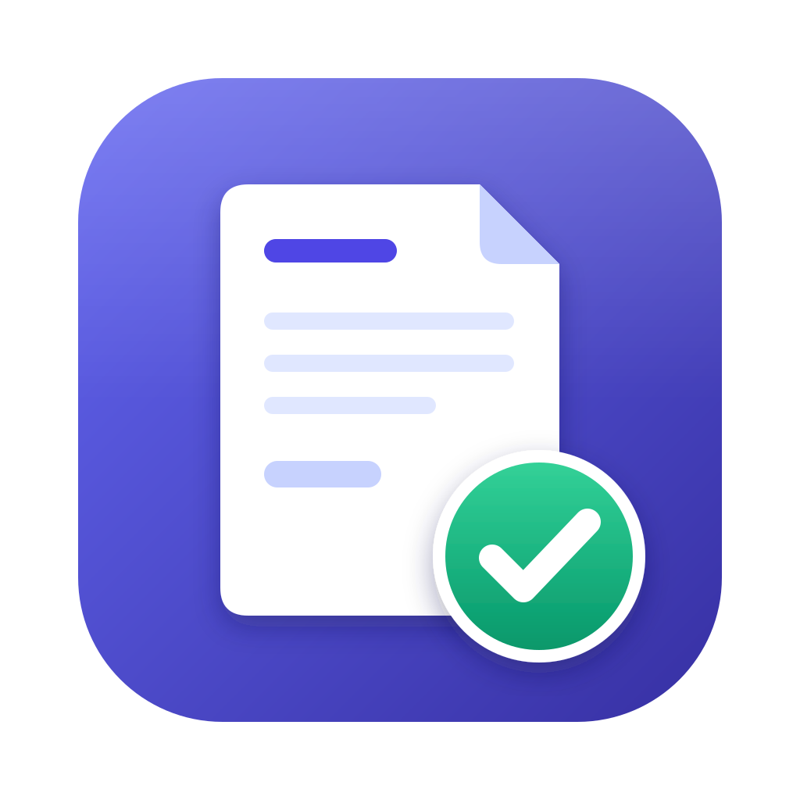

<h1 align="center">Evidenta</h1>

Fakture, knjiga prihoda, porezi i doprinosi za samostalne preduzetnike u Republici Srpskoj.

<b>Najnovija verzija: 1.0.4</b> (11.11.2026.) · <a href="https://github.com/gligor99/evidenta-releases/releases/latest">Preuzmi</a>

## Preuzimanje

Otvorite [najnovije izdanje](https://github.com/gligor99/evidenta-releases/releases/latest) i preuzmite fajl za svoj sistem:

| Sistem | Fajl |
|---|---|
| Windows | `Evidenta-Setup-x.y.z.exe` |
| macOS (Apple M1–M4) | `Evidenta-x.y.z-arm64.dmg` |
| macOS (Intel) | `Evidenta-x.y.z.dmg` |
| Linux | `Evidenta-x.y.z.AppImage` ili `evidenta_x.y.z_amd64.deb` |

## Instalacija

Evidenta još nije potpisana plaćenim certifikatom, pa sistem pri prvom pokretanju traži potvrdu. To se radi samo jednom.

- **Windows:** ako se pojavi „Windows protected your PC“, kliknite *More info* → *Run anyway*.
- **macOS:** prevucite Evidentu u *Applications* i pokrenite je. Kad javi da se ne može otvoriti, kliknite *Done*, pa *System Settings → Privacy & Security → Open Anyway*.
- **Linux:** `sudo apt install ./evidenta_*_amd64.deb`, ili `chmod +x Evidenta-*.AppImage` pa pokrenite.

Probni period traje 30 dana. Ključ licence unosite u *Postavke → Licenca i ažuriranja*.

## Šta je novo

### 1.0.4 — 11.11.2026.

- **Pouzdanija provjera licence i probnog perioda:** probni period se računa od prvog korištenja i ostaje tačan i nakon reinstalacije ili kad sat na računaru nije dobro podešen. Pri pokretanju aplikacija sa GitHuba preuzima tačan datum; vaši podaci se pri tome ne šalju.
- Uvoz backupa (*Postavke → Podaci i backup*) traži aktivnu licencu ili probni period. Pregled, PDF i izvoz podataka rade i nakon isteka, kao i do sada.

### 1.0.3 — 11.11.2026.

- **Tamna tema:** u *Postavke → Izgled aplikacije* izaberite Svijetlu, Tamnu ili „Kao sistem“. Fakture, uplatnice i PDF ostaju svijetli, kao na papiru.
- **Jasniji pragovi na početnoj:** prikazuje se limit od 100.000 KM za malog preduzetnika (sa upozorenjem kad mu se približite), a minimalni porez (600 KM do 50.000 KM prihoda, 1.200 KM preko toga) je posebno objašnjen.
- **Tačna cijena stavke:** cijena sa više decimala (npr. 0,125 KM po komadu) više se ne zaokružuje pri čuvanju, pa iznos fakture ostaje tačan.
- Faktura vraćena na „neplaćenu“ ponovo se zatvara ponovnim uvozom istog izvoda.
- Uvezene fakture sa godinom u broju (npr. INV-2026-0005) više ne pomjeraju numeraciju novih faktura.

### 1.0.2 — 09.11.2026.

- **Ljepši QR kod za plaćanje:** zaobljene tačke i Evidenta znak u sredini, manji, sa natpisom „Instrukcije za plaćanje“ / „Payment instructions“.
- Podaci za plaćanje pored QR koda ostaju u jednom redu.
- Savjet: kraći link (npr. vlastiti kratki link koji vodi na bankin) daje QR sa mnogo manje tačkica.

### 1.0.1 — 09.11.2026.

- **Uvoz izvoda iz bilo koje banke, CSV ili PDF:** izvod ili pregled transakcija preuzet iz e-bankinga se čita sam, bez obzira na format (npr. novi ProCredit PDF izvodi).
- Provizije banke iz pregleda transakcija pripisuju se odgovarajućoj uplati, a naknada za održavanje računa ide u troškove. Ista transakcija iz izvoda i iz pregleda upisuje se samo jednom.
- **QR kod za plaćanje na fakturi:** u *Postavke → Bankovni računi* zalijepite link za instrukcije plaćanja iz e-bankinga (domaći za KM račun, inostrani za devizni). Kupac skenira QR telefonom i dobije podatke za uplatu. Uključuje se i isključuje u izboru polja fakture.

### 1.0.0 — 17.10.2026.

Prvo zvanično izdanje Evidente.

#### Poslovanje
- **Klijenti, fakture i profakture** sa četiri šablona, na bosanskom, engleskom ili dvojezično, u KM, EUR ili USD.
- **Nacrt → izdata faktura:** izdata se ne mijenja, ispravka ide preko storna. Svaka izmjena se bilježi u dnevnik.
- **Uvoz postojećih faktura** iz bilo kog programa, i skeniranih ili fotografisanih (PDF, JPG, PNG), bez interneta. Ulazni računi idu u troškove.
- **Uvoz izvoda iz banke (CSV):** uplate zatvaraju fakture, a porez, doprinosi i troškovi se upisuju sami.
- **Radni sati** sa tajmerom i prebacivanjem na fakturu.

#### Knjigovodstvo
- **Knjiga prihoda** koja se vodi sama, **troškovi** po kategorijama i **izvoz u Excel** za knjigovođu.
- **Porez 2%** i godišnji minimum, zvanični **Obrazac 1007** (mjesečni i godišnji), **doprinosi** i evidencija uplata sa datumom.
- **Uplatnice** za javne prihode, popunjene i sa predlošcima, sa linijama za potpis nalogodavca i ovlaštenog lica.
- **Rokovi na početnoj, podsjetnici** i dodavanje rokova u Google, Apple ili Outlook kalendar.

#### Ostalo
- Statistika, čarobnjak za prvo pokretanje, lokalna baza, dnevni backup i vraćanje kopije.
- Probni period od 30 dana. **Kupovina licence direktno iz aplikacije** (*Postavke → Licenca i ažuriranja*).
- Automatska ažuriranja na Windowsu i Linuxu, obavijest o novoj verziji na macOS-u. Verzije za Windows, macOS (Apple Silicon i Intel) i Linux.
